# シーケンス図

## 1. オペレータログイン

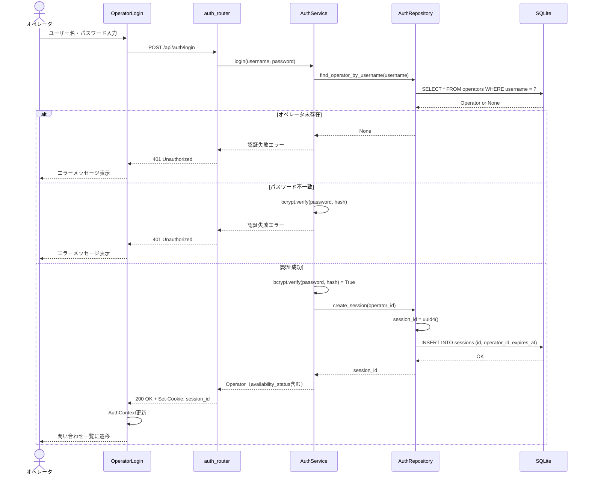

## 2. 問い合わせ一覧取得（未完了 + 完了済み）

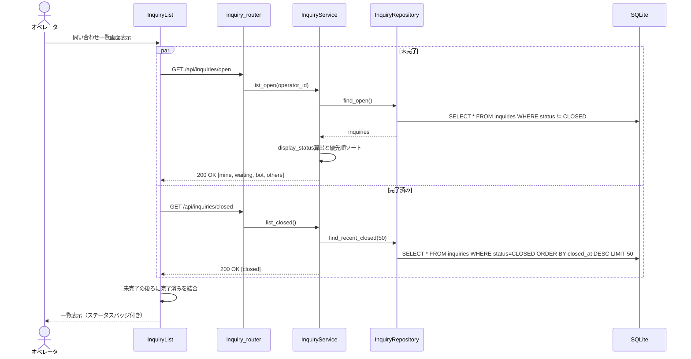

## 3. 問い合わせ担当取得（排他制御）

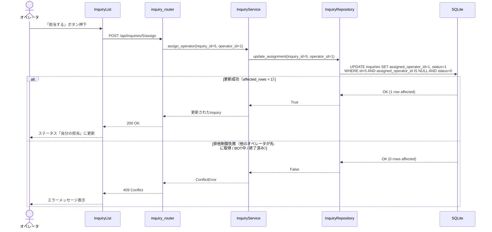

## 4. BOT事前質問の開始

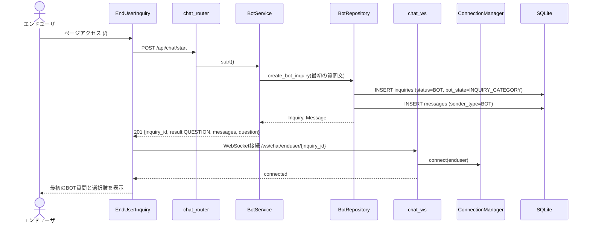

## 5. BOT回答とオペレータ対応への移行

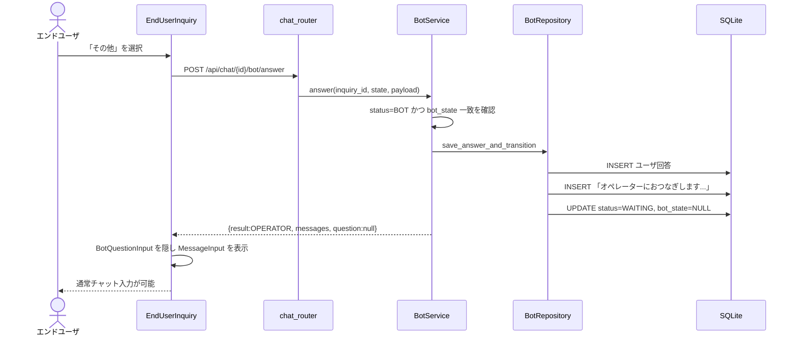

## 6. メッセージ送受信（オペレータ対応中）

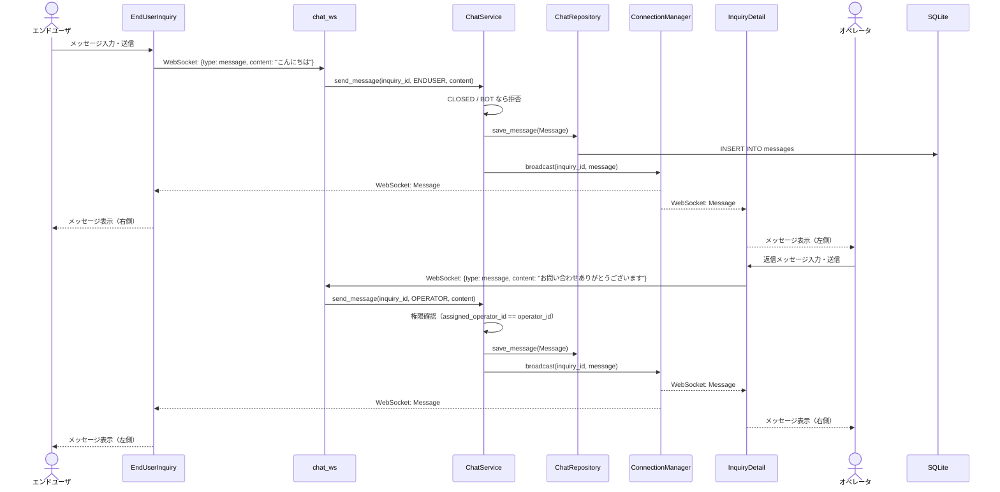

## 7. セッション終了（明示的な終了ボタン）

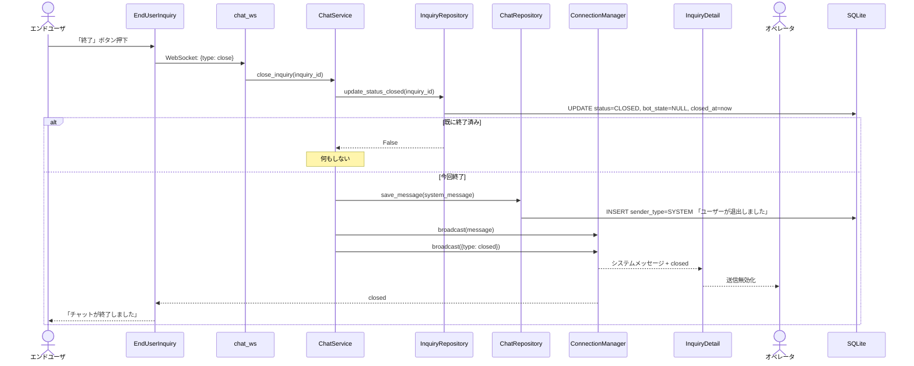

## 8. セッションタイムアウト

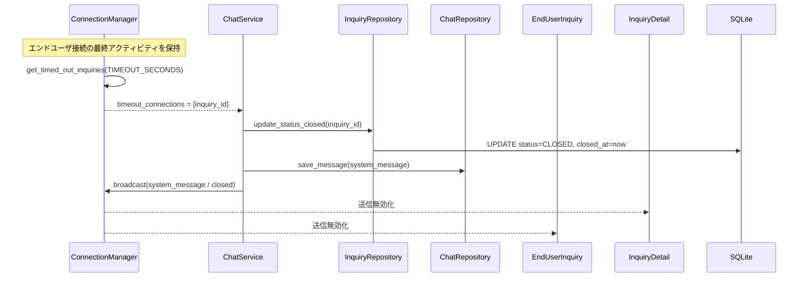

## 9. オペレータ ログアウト

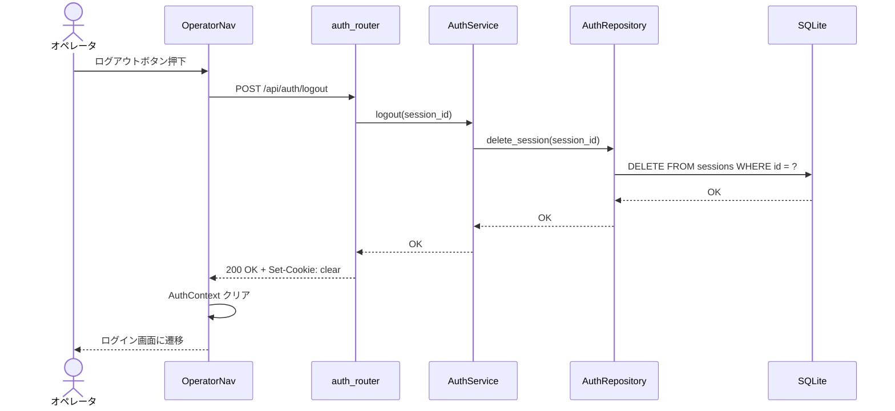

## 10. オペレータ稼働状態の更新

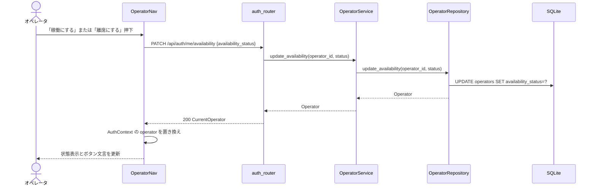

## 11. オペレータ追加

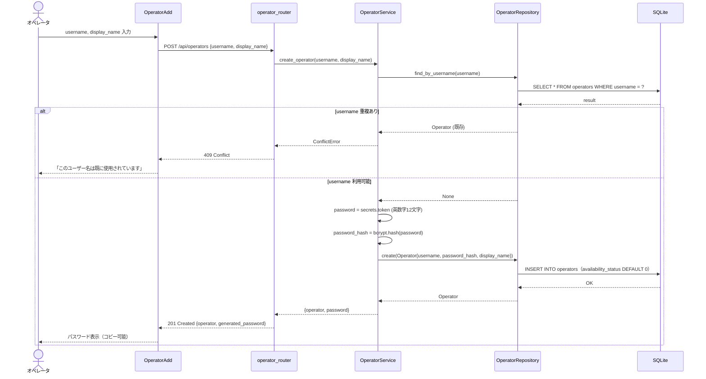

## 12. オペレータ削除

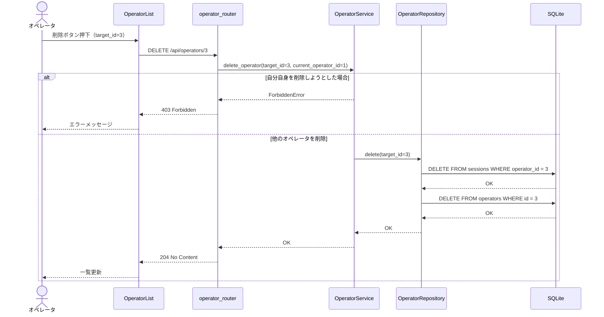

## 13. 推定待ち時間の取得

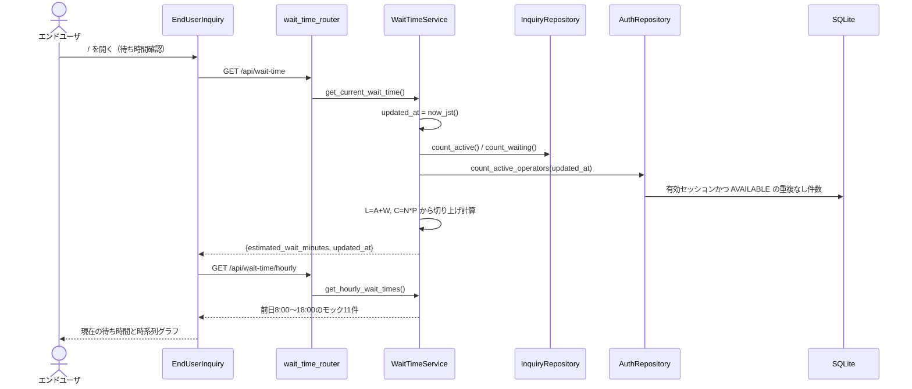

## 14. サマリーボード

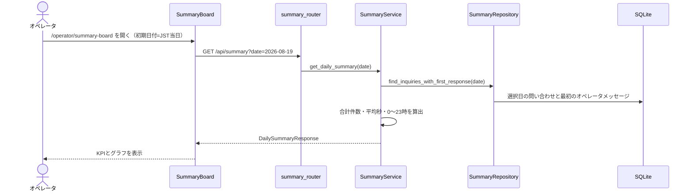
